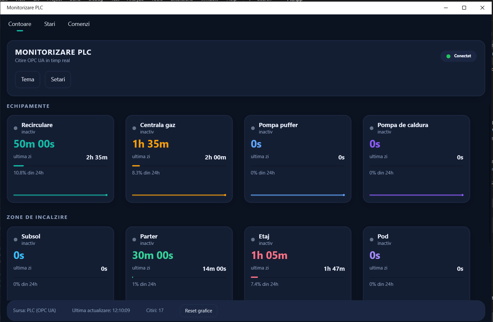
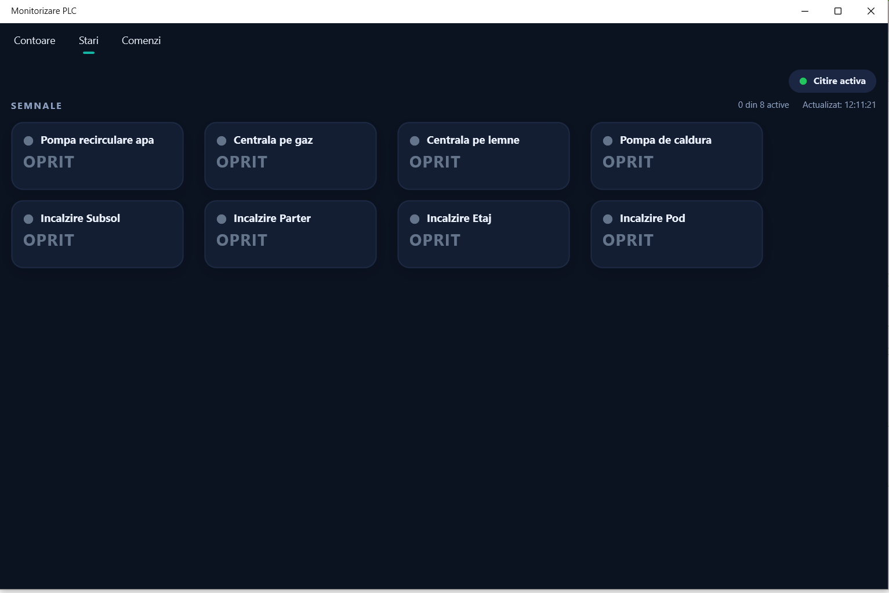
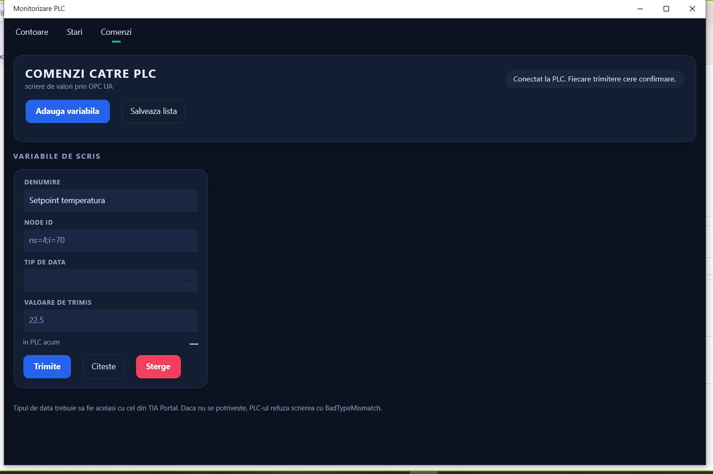

# PlcApp — Heating System Monitor over OPC UA

A cross-platform desktop and mobile client that connects to a Siemens PLC over
OPC UA and displays the live operating state of a residential heating system:
run-time counters per circuit, digital status signals, and write-back commands.

Built with **.NET MAUI** (C#), targeting **Windows** and **Android** from a
single codebase. Ported from an earlier Python implementation
(PySide6 + `asyncua`).

> **Note on the PLC side:** this repository contains only the client
> application. The PLC program itself is configured in TIA Portal and is not
> part of this project.

---

## Screenshots

<!-- Add screenshots here: docs/PLC-Monitor.png, docs/PLC-Monitor stari.png, docs/PLC-Monitor comenzi.png -->

### Counters


### Status


### Commands


## Features

**Three tabs**

- **Contoare (Counters)** — run-time totals per device and per heating zone,
  each as a card with a progress bar and a sparkline of the current session,
  plus a countdown to the next recirculation cycle.
- **Stari (Status)** — digital signals read from a boolean array node, shown as
  on/off indicators with an active count and a last-update timestamp.
- **Comenzi (Commands)** — user-defined write targets. Each entry has a node ID,
  a data type, optional min/max bounds, and a confirmation dialog before the
  value reaches the PLC. The list is stored locally, so adding a new variable
  does not require recompiling.

**Behaviour**

- Automatic connection and reconnection: a supervisor retries every 5 seconds
  while disconnected, including after the read loop drops out.
- Resilient read loop: on failure the error surfaces in the UI and the client
  retries; after 5 consecutive errors it closes the session and lets the
  supervisor reconnect cleanly.
- Configurable time unit (raw / seconds / minutes / hours) applied instantly to
  all counters without reconnecting.
- Light and dark theme, remembered between runs.
- Responsive layout that collapses below 760 px for phone screens.
- Settings (host, time unit, theme, command list) persist via MAUI
  `Preferences`.

---

## Tech stack

| Area | Technology |
|---|---|
| UI framework | .NET MAUI (net9.0-windows, net9.0-android) |
| Language | C# 12, nullable enabled |
| MVVM | CommunityToolkit.Mvvm (source generators) |
| Industrial protocol | OPCFoundation.NetStandard.Opc.Ua.Client |
| Drawing | Microsoft.Maui.Graphics (`GraphicsView` sparklines) |
| Installer | Inno Setup |

---

## Architecture

```
PlcApp/
├─ Services/
│  ├─ IPlcDataSource.cs            common interface for any data source
│  ├─ OpcUaPlcDataSource.cs        real OPC UA client (connect, read, write)
│  └─ SimulatedPlcDataSource.cs    fake source for UI testing without a PLC
├─ ViewModels/
│  ├─ MainViewModel.cs             connection, read loop, counter formatting
│  ├─ StatusViewModel.cs           boolean signal polling
│  └─ ControlViewModel.cs          write targets, parsing and validation
├─ Models/
│  ├─ MetricItem.cs                one counter card
│  ├─ BoolSignal.cs                one status indicator
│  ├─ PlcCommand.cs                one user-defined write target
│  └─ TimeFormat.cs                raw value → formatted duration
├─ Drawables/SparklineDrawable.cs  per-card miniature chart
├─ Views/                          MainPage, StatusPage, ControlPage, tab host
└─ Resources/Styles/               colors and styles (light + dark)
```

The three view models share a **single OPC UA session**. `MainViewModel` owns
the connection and is registered as a singleton; `StatusViewModel` and
`ControlViewModel` observe its `IsConnected` property and read through its
`ActiveSource`, so the client never opens more than one session against the PLC.

`SimulatedPlcDataSource` exists in `Services/` for exercising the UI without
hardware. It is not currently wired into the application shell — only the
OPC UA source is registered in `MauiProgram.cs`.

---

## Configuration

### PLC address

**The repository contains no real PLC address.** The default in
`MainViewModel.DefaultHost` is a placeholder (`192.168.0.100`).

On first run, open **Setari → ADRESA PLC**, enter your own address and press
Enter. The value is saved to local `Preferences` and reused on every later
start. The field accepts either form:

```
192.168.1.50            → connects on the default port 4840
my-plc.example.com:50   → connects on the explicit port 50
```

### Node IDs

| Purpose | Node | Type |
|---|---|---|
| Run-time counters | `ns=4;i=71` | array of 17 integers |
| Digital status signals | `ns=4;i=6` | `Array[0..63] of Bool` |

Counter nodes are set in code (`MainViewModel.LoadSettings` and
`StatusViewModel.BoolNode`). Write targets are configured at runtime from the
Commands tab.

### Counter array layout

| Index | Meaning | Index | Same, previous day |
|---|---|---|---|
| 0 | Recirculation pump | 4 | — |
| 1 | Gas boiler | 5 | — |
| 2 | Puffer pump | 6 | — |
| 3 | Heat pump | 7 | — |
| 8 | Heating, basement | 12 | — |
| 9 | Heating, ground floor | 13 | — |
| 10 | Heating, first floor | 14 | — |
| 11 | Heating, attic | 15 | — |
| 16 | Time until next recirculation | | |

Labels and indices live in one place: the `MainViewModel` constructor.

### Status bit layout

Bits 0–7 are named (recirculation pump, gas boiler, wood boiler, heat pump, and
the four heating zones). The remaining bits up to 64 are read but hidden unless
`ShowAllBits` is set.

---

## Building and running

**Requirements**

- Visual Studio 2022 (17.12 or newer)
- Workload: *.NET Multi-platform App UI development* (installs the .NET 9 SDK
  and the Android SDK)

If you are on .NET 8, edit `TargetFrameworks` in `PlcApp/PlcApp.csproj` to
`net8.0-android;net8.0-windows10.0.19041.0`.

**Run**

1. Open `PlcApp.sln`.
2. Let the first build restore the NuGet packages.
3. Pick a target: **Windows Machine**, an **Android Emulator**, or a connected
   phone with USB debugging enabled.
4. Press F5.

On Android, the phone must be able to reach the PLC — on the same local network,
or through whatever remote access you have configured.

**Publish a self-contained Windows build**

```
dotnet publish PlcApp/PlcApp.csproj -f net9.0-windows10.0.19041.0 -c Release ^
  -p:RuntimeIdentifier=win-x64 -p:SelfContained=true -p:WindowsAppSDKSelfContained=true
```

The app is configured as *unpackaged* (a plain `.exe`, no MSIX). Compile
`MonitorizarePLC.iss` with Inno Setup to produce a single installer.

**Skip the Android target** by removing `net9.0-android;` from
`TargetFrameworks` — the build gets noticeably faster and the Android SDK is no
longer required.

---

## Known limitations

These are deliberate trade-offs for a small private installation, not
recommendations for production:

- **No OPC UA security.** The client connects anonymously with
  `useSecurity: false` and auto-accepts the PLC's self-signed certificate,
  matching the behaviour of the original `asyncua.Client` setup. A production
  deployment should use a signed-and-encrypted endpoint with certificate
  validation.
- **Remote access.** If the PLC is reachable from outside the local network,
  it should sit behind a VPN rather than a forwarded port. An unsecured OPC UA
  endpoint on a public port is scannable.
- **Polling, not subscriptions.** The client reads the node on a timer (default
  1 s). OPC UA subscriptions would be more efficient; polling was chosen for
  simplicity, and one second is well within what heating-system monitoring
  needs.
- **Android trimming disabled.** The OPC UA stack uses reflection, so trimming
  and AOT are turned off for Release Android builds to keep runtime types
  available. This increases package size.

---

## Development notes

This project was built using **AI-assisted development**. AI models were used as
a pair-programming tool — for scaffolding, for working through MAUI and OPC UA
stack issues, and for the Python-to-C# port. Requirements, the PLC data mapping,
the architecture decisions and all debugging and validation against the live
installation are my own; every generated change was reviewed and tested on real
hardware before being kept.

---

## License

MIT — see [LICENSE](LICENSE).
